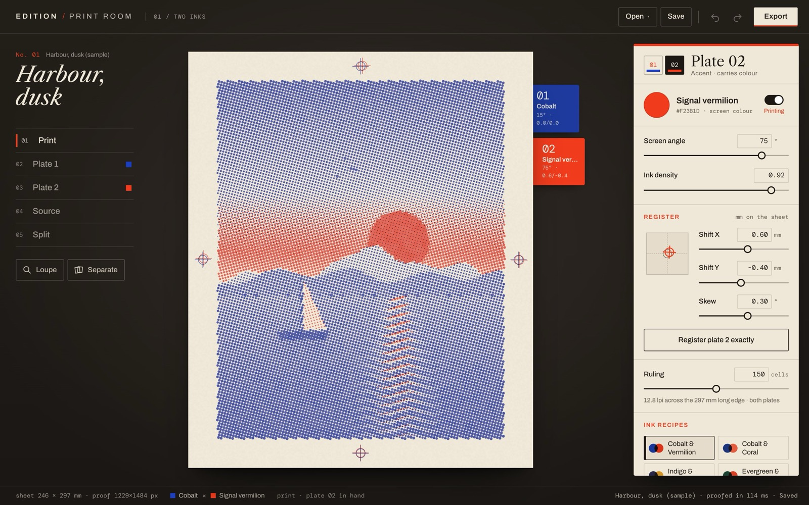
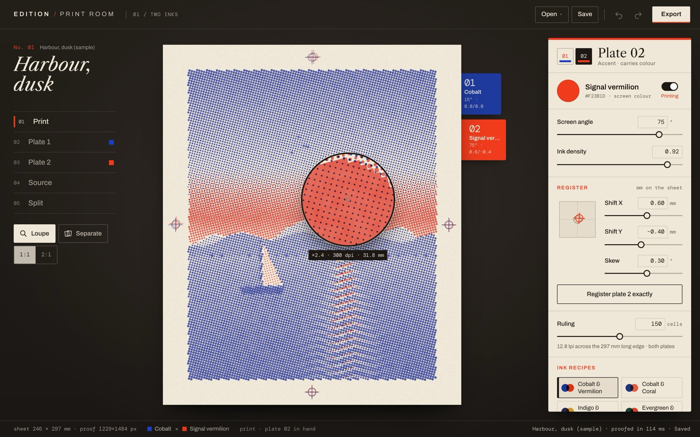
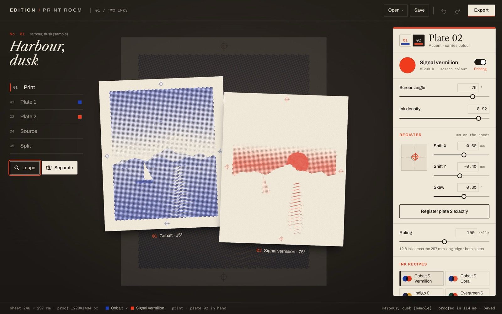
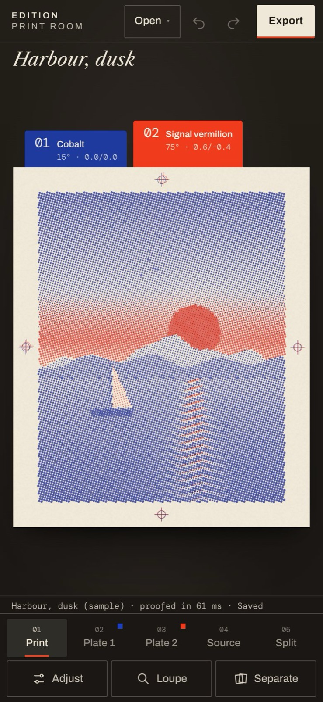

# Edition — The Print Room

**A two-ink printmaking studio for the browser.** A photograph becomes a print through two editable ink separations: real halftone plates, set at their own angles, overprinted on paper — and slightly, deliberately, out of register. You pick a plate up by its tab and push it across the sheet.



**Live:** https://mariaareadne1.github.io/edition/ · **Source:** this repository · MIT · Your images never leave your browser.

## The room

- **The press table.** The print sits on a dark, warm table as a sheet of paper, larger than anything else on screen. The title is set in the margin; beneath it an index of views — **Print · Plate 1 · Plate 2 · Source · Split** — and two hand tools, **Loupe** and **Separate**. A slug line along the bottom states the facts: sheet size, proof size, inks, view, the plate in hand, render and save state.
- **Plates as tabs.** The two plates are index tabs tucked under the sheet's edge, in their own inks, with their angle and current offset. The plate in hand stands proud. **Drag the print to move it** (one drag = one undo step) with a live millimetre readout under your pointer; the registration marks in the margin double up exactly as they would on press, because the marks are printed by each plate through the same transform. Arrow keys nudge 0.1 mm (Shift: 1 mm); holding a key is one undo step. `1` / `2` pick up a plate.
- **The loupe** (`L`) shows the **export's own pixels**: the window under the pointer is rendered by the engine at A4 / 300 dpi and drawn 1:1 (or 2:1) with no smoothing — dot shape, screen angle, overprint and grain as they will be in the file. Tested pixel-identical to the downloaded PNG.
- **Separate** (hold the button or `S`) lifts the two plates apart side by side — each one rendered alone by the engine, with its registration — and drops them back when you let go.
- **Split** wipes between source and print with a handle on the sheet itself (draggable, or a keyboard slider).
- **The ink tray** holds what you reach for while printing: the plate in hand (ink colour, printing on/off, screen angle, density, register X/Y/skew with a to-scale register pad, *register exactly*), the screen ruling, and the ink recipes — **Cobalt & Vermilion** (default), Cobalt & Coral, Indigo & Ochre, Evergreen & Vermilion. The **workshop drawer** folds away the separation (contrast, key density, accent pickup, how much the key gives way) and the paper (tone, tooth, ink mottle, margin, marks, grain seed). Ink names describe a screen colour, not a press-ink match.
- **On a phone** the print fills the width; views and tools dock at the bottom (safe-area aware) and the tray rises as a bottom sheet that Back or Escape closes. A one-finger drag moves the plate; a second finger cancels the drag without an undo step.
- **Open / Save / Export.** Open a JPEG, PNG or WebP (or drop it anywhere — checked by size, magic bytes and header dimensions before decoding, analysed at up to 1800 px), an `.edition` project, or the sample. **Save** downloads an `.edition` project (settings + the original image bytes). **Export** renders `print-composite.png`, `ink-1.png`, `ink-2.png` (registered black-on-white films) at A4 300 dpi (2905 × 3508 for a 4:5 image), A4 150 dpi or 2400 px, in a worker, with progress and cancel.
- Undo/redo, autosave to IndexedDB, and a reload restores the same print byte-for-byte. A saved print that can't be read is copied aside, never overwritten.

| Loupe — 300 dpi export pixels | Separate — the plates lifted apart | Phone |
| --- | --- | --- |
|  |  |  |

## The model

Everything is defined in **sheet units** (1 = the sheet's long edge, 297 mm), so a 650 px preview, the loupe and a 3508 px export describe the same print.

1. **Separation** (`src/engine/separations.ts`). Each pixel is composited over the paper in linear light and converted to OKLab.
   - Key plate (tone): `T = (L_paper − L) / L_paper`, shaped `T′ = clamp(0.5 + (T − 0.5)·contrast + density)`.
   - Accent plate (colour leaning toward ink 2's hue, measured relative to the paper's tint): `A = clamp(C / 0.16) · max(0, cos∠(ab, hue₂))²`, `c₂ = clamp(accent · A)`.
   - The key gives way under the accent: `c₁ = T′ · (1 − balance · c₂)`.
   Two inks cannot reproduce arbitrary colour; this is an interpretive, deterministic mapping, not a colour-accurate separation. A neutral accent ink has no hue, so its plate is empty.
2. **Halftone** (`src/engine/halftone.ts`, `render.ts`). An AM screen of round dots at each plate's angle. Each cell samples coverage at its centre and inks the dot whose area — the circle clipped to the cell — equals that coverage **exactly**, so dot size is monotonic in darkness and a flat field of coverage *c* inks a fraction *c* of the paper. Edges are anti-aliased analytically; cells under 8 px are supersampled.
3. **Registration.** Each plate's offset and rotation are applied by mapping output pixels into the plate's frame before the screen is evaluated — the dots (and that plate's marks) move, never a screenshot.
4. **Composite.** `out = paper · Π (1 − α·density·(1 − ink))` per channel in linear light: transparent inks overprinting multiplicatively. It is an optical approximation, not a spectral or ICC proof. Paper tooth and ink mottle are seeded value noise defined in sheet units.
5. **Films** are each plate's coverage at registration, black on white — what you would expose a screen or plate from.

The redesign changed no engine code: a golden test renders five fixtures in every mode against hashes recorded before the redesign. Everything the room adds — the view, the plate in hand, the loupe, lifted plates, tray and drawer — is editor state outside the document, so it never enters the undo history or an export.

Colour management: images are decoded by the browser into sRGB (wide-gamut sources are clipped); there is no ICC proofing.

## Verification

| Check | Command | Result (2026-10-26) |
| --- | --- | --- |
| Types (strict) · lint · build | `pnpm typecheck` · `pnpm lint` · `pnpm build` | pass |
| Engine, import, golden outputs, studio state | `pnpm test` | 29 / 29 |
| Browser journeys — Chromium **and** WebKit | `pnpm test:e2e` | 24 / 24 Chromium · 23 / 23 WebKit (+1 Chromium-only touch test skipped) |
| Exported files, inspected independently (Python + Pillow) | `scripts/export-fixtures.mjs` → `scripts/inspect_exports.py` | 5 / 5 fixtures pass |

What the tests establish (in addition to the original separation, screen and import checks):
- **Golden outputs:** grey ramp, flat swatches (accent and complement), hard diagonal edges, a partly transparent disc and a detailed scene render the pre-redesign pixels in `print`, `film1`, `film2` and `source`.
- **Loupe = export:** the loupe's pixels compared with the same window of the downloaded A4/300 dpi composite: 0 of 35,344 differ in Chromium (1× DPR), 0 of 141,376 in WebKit (2× DPR).
- **Export parity:** the A4/300 dpi composite matches the on-screen proof averaged over the same sheet regions in linear light — mean **0.09/255** (worst block 0.54) against a 614 px proof in Chromium, 0.29/255 (worst 2.03) against a 1229 px proof in WebKit.
- **Registration is real:** in every fixture's exported files, plate 1's marks sit within 0.04 mm of register and plate 2's land +0.65…0.71 / −0.39…0.49 mm from its registered film, for a configured +0.60 / −0.40 mm (≈1 px at 300 dpi; the remainder is the 0.3° skew). Offsets move only the composite; films stay registered; angles change the film.
- **Interaction:** drag moves the plate in hand by the expected millimetres as one undo step; switching views, tools or plates adds no undo step and keeps focus; undo/redo after a drag and after a reload; arrow keys and held keys; split handle by keyboard; lifted plates are two distinct engine renders and leave the print untouched; ink recipes and custom colours each one undo step; export cancel writes nothing; the drag hint goes once used.
- **Phone:** the print is >85 % of the width with no horizontal overflow; the tray opens as a bottom sheet and Back/Escape close it; a touch drag moves the plate and a second finger cancels it with no undo step (Chromium, driven through the DevTools protocol).
- **Robustness:** invalid numbers rejected; fake and 400 MP-header files refused before decoding; a 17.5 MP image imports; an unreadable saved print is preserved; bursts of changes end on a proof identical to a fresh render.

**Not verified:** Firefox; real phones and tablets (touch is emulated); screen readers beyond accessibility-tree checks; 100 MP inputs (the limit is enforced, only 17.5 MP exercised); colour accuracy against physical inks (not claimed).

## Run it

```bash
pnpm install
pnpm dev                        # http://localhost:5411
pnpm test && pnpm test:e2e
node scripts/screenshots.mjs    # regenerate docs/media (dev server running)
node scripts/capture.mjs after  # four viewports × Chromium/WebKit + videos → artifacts/ (git-ignored)
```

## Layout

```
src/engine/   color · separations · halftone · render · sample — pure TypeScript, no DOM (unchanged by the redesign)
src/worker/   render.worker.ts (preview bands, cropped loupe windows, export) · pool.ts (latest-wins lanes, watchdog, export job)
src/image/    import.ts — validation, decode, downscale
src/state/    document.ts (versioned schema, palettes) · history.ts · useEdition.ts · useStudio.ts (editor/presentation state)
src/storage/  db.ts — IndexedDB (document + original image bytes)
src/ui/       Masthead · ViewRail · Stage · PlateTabs · Loupe · InkTray · StatusStrip · ExportDialog · Field
src/styles/   tokens · base · table · stage · tray · dialog
```

See [DECISIONS.md](DECISIONS.md), [PROGRESS.md](PROGRESS.md) and [docs/redesign/](docs/redesign/BASELINE.md).

## Credits

By [Maria Showalter](https://mariashowalter.com). Fonts: Libre Caslon Text, Archivo, DM Mono (SIL OFL) via Fontsource. Zip: fflate (MIT). OKLab conversion after Björn Ottosson (public formulae). See [THIRD_PARTY_NOTICES.md](THIRD_PARTY_NOTICES.md).
