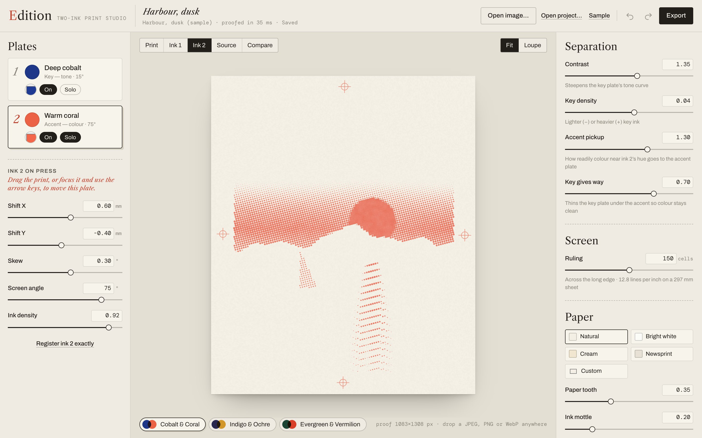
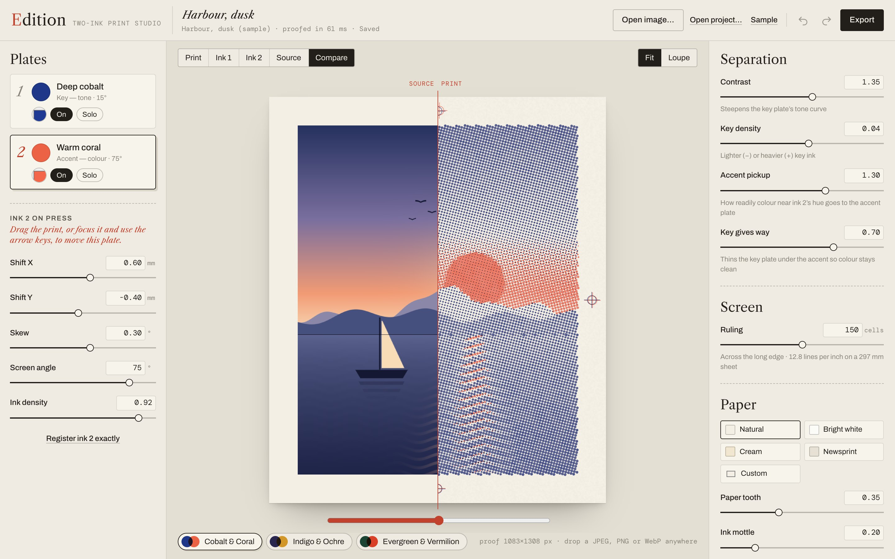

# Edition

**A two-ink printmaking studio for the browser.** A photograph becomes a print through two editable ink separations: real halftone plates, set at their own angles, overprinted on paper — and slightly, deliberately, out of register.


**Live:** https://mariaareadne1.github.io/edition/ · **Source:** this repository · MIT · Your images never leave your browser.

## What you can do

- **Open a photograph** (JPEG, PNG or WebP — file picker or drag-and-drop). It is checked by size, magic bytes and decode, and analysed at up to 1800 px on its long edge. Or start from *Harbour, dusk*, an original sample painted in code.
- **Choose two inks.** Three palettes — Cobalt & Coral, Indigo & Ochre, Evergreen & Vermilion — or any colours. Names describe the look; they are screen approximations, not press inks.
- **Read the plates.** View the print, either ink alone, the source, or a split comparison. Turn inks on and off.
- **Misregister on purpose.** Drag the print to move the active plate (one drag = one undo step), or type exact millimetre shifts and a small skew. Arrow keys nudge 0.1 mm (Shift: 1 mm). The registration marks in the margin double up exactly as they would on press.
- **Shape the separation and screen.** Contrast, key density, accent pickup and how much the key gives way under the accent; screen ruling; each plate's angle and ink density; paper tone, tooth, ink mottle (seeded), margin and marks.
- **Export at full size.** `print-composite.png`, `ink-1.png`, `ink-2.png` (registered black-on-white films) at A4 300 dpi (2905 × 3508 for a 4:5 image), A4 150 dpi or 2400 px — rendered by the same engine, in a worker, with progress and cancel. Save a `.edition` project (settings + the original image bytes) or settings-only `.json`.
- Undo/redo, autosave to IndexedDB, and reload restores the same print byte-for-byte.

| Ink 2 alone | Source ↔ print | Loupe |
| --- | --- | --- |
|  |  |  |

## The model

Everything is defined in **sheet units** (1 = the sheet's long edge, 297 mm), so a 650 px preview and a 3508 px export describe the same print.

1. **Separation** (`src/engine/separations.ts`). Each pixel is composited over the paper in linear light and converted to OKLab.
   - Key plate (tone): `T = (L_paper − L) / L_paper`, shaped `T′ = clamp(0.5 + (T − 0.5)·contrast + density)`.
   - Accent plate (colour leaning toward ink 2's hue, measured relative to the paper's tint): `A = clamp(C / 0.16) · max(0, cos∠(ab, hue₂))²`, `c₂ = clamp(accent · A)`.
   - The key gives way under the accent: `c₁ = T′ · (1 − balance · c₂)`.
   Two inks cannot reproduce arbitrary colour; this is an interpretive, deterministic mapping, not a colour-accurate separation. A neutral accent ink has no hue, so its plate is empty.
2. **Halftone** (`src/engine/halftone.ts`, `render.ts`). An AM screen of round dots at each plate's angle. Each cell samples coverage at its centre and inks the dot whose area — the circle clipped to the cell — equals that coverage **exactly** (inverse-area table), so dot size is monotonic in darkness and a flat field of coverage *c* inks a fraction *c* of the paper. Edges are anti-aliased analytically; cells under 8 px are supersampled.
3. **Registration.** Each plate's offset and rotation are applied by mapping output pixels into the plate's frame before the screen is evaluated — the dots move, never a screenshot.
4. **Composite.** `out = paper · Π (1 − α·density·(1 − ink))` per channel in linear light: transparent inks overprinting multiplicatively. It is an optical approximation, not a spectral or ICC proof. Paper tooth and ink mottle are seeded value noise defined in sheet units.
5. **Films** are each plate's coverage at registration, black on white — what you would expose a screen or plate from.

Colour management: images are decoded by the browser into sRGB (wide-gamut sources are clipped); there is no ICC proofing.

## Verification

| Check | Command | Result (2026-10-21) |
| --- | --- | --- |
| Types (strict) · lint · build | `pnpm typecheck` · `pnpm lint` · `pnpm build` | pass |
| Engine unit tests | `pnpm test` | 20 / 20 |
| Browser journeys — Chromium **and** WebKit | `pnpm test:e2e` | 10 / 10 per engine |

What the tests establish:
- **Separation:** white needs no ink; black needs full key; key coverage is monotonic along a grey ramp; coverage stays in [0, 1]; the accent plate takes coral and red but not green or blue; transparent pixels on cream paper print nothing; deterministic.
- **Screen:** dot area round-trips its inverse; a uniform plate inks the requested fraction (0–100 %) within 2 %, and within 3 % at 2.5 px cells; a plate offset of (10, −4) px moves the pattern by exactly that; angle changes the pattern but not the coverage.
- **Export parity:** the A4/300 dpi composite, parsed from the downloaded PNG, matches the on-screen proof when both are averaged over the same sheet regions in linear light — mean **0.15/255** (worst block 0.97) against a 542 px proof in Chromium; mean 0.37/255 (worst 2.96) against a 1083 px proof in WebKit.
- **Export reflects the controls:** shifting ink 2 changes the composite PNG but not the ink-2 film (films are registered); changing ink 2's screen angle changes its film.
- **Journeys:** drag moves the plate by the expected millimetres and undoes in one step; keyboard nudges; invalid numbers rejected; a valid photo imports and reloads to a byte-identical proof; a text file named `.png` is refused; a 17.5 MP image imports without crashing; a burst of rapid slider changes ends on a proof identical to a fresh render of the final settings; no horizontal overflow at 390 px.

**Not verified:** Firefox; real phones (touch is emulated); 100 MP inputs (the limit is enforced but only a 17.5 MP file is exercised); colour accuracy against physical inks (not claimed).

## Run it

```bash
pnpm install
pnpm dev                        # http://localhost:5411
pnpm test && pnpm test:e2e
node scripts/screenshots.mjs    # regenerate docs/media (dev server running)
```

## Layout

```
src/engine/   color · separations · halftone · render · sample — pure TypeScript, no DOM
src/worker/   render.worker.ts (preview bands + export) · pool.ts (latest-wins pool, export job)
src/image/    import.ts — validation, decode, downscale
src/state/    document.ts (versioned schema, palettes, validation) · history.ts · useEdition.ts
src/storage/  db.ts — IndexedDB (document + original image bytes)
src/ui/       PrintCanvas · PlateStack · Inspector · PaletteStrip · ExportDialog · TopBar · Field
```

See [DECISIONS.md](DECISIONS.md) and [PROGRESS.md](PROGRESS.md).

## Credits

By [Maria Showalter](https://mariashowalter.com). Fonts: Libre Caslon Text, Archivo, DM Mono (SIL OFL) via Fontsource. Zip: fflate (MIT). OKLab conversion after Björn Ottosson (public formulae). See [THIRD_PARTY_NOTICES.md](THIRD_PARTY_NOTICES.md).
